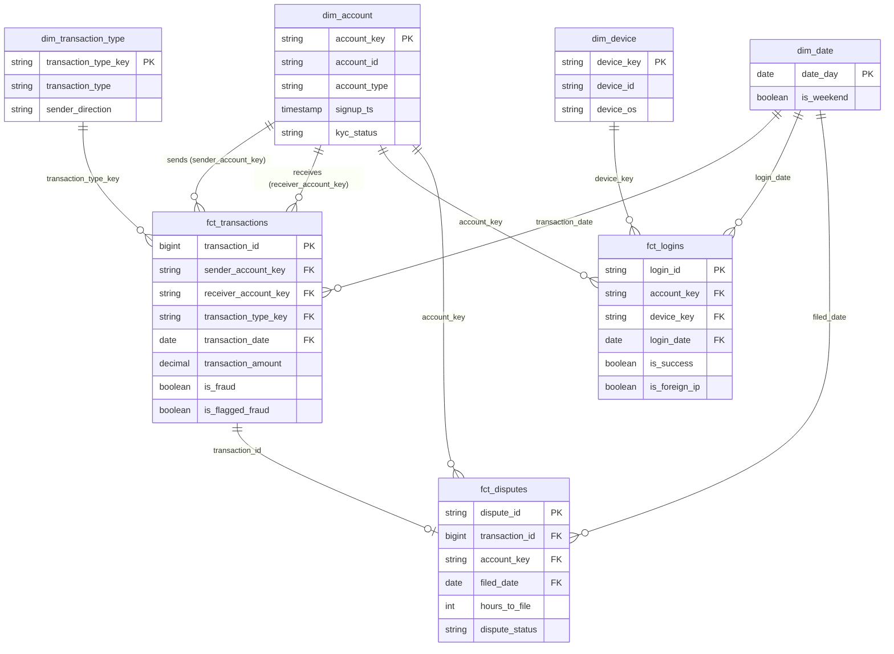

# Payments Risk Warehouse

[](https://github.com/karthikrk1/payments-risk-warehouse/actions/workflows/ci.yml)

A dbt-based risk data platform for a peer-to-peer payments product: it turns raw transaction,
account, device, login and dispute data into a tested **dimensional warehouse** and a
**point-in-time-correct ML feature table** for fraud detection, with data quality and lineage
monitoring built in.

> **Status:** Phase 1 complete: warehouse, point-in-time features, tests, CI and hosted docs.
> Phase 2 under way: Prefect orchestration with day-by-day replay, custom data monitoring with a chart
> page, and an AI triage agent for failed builds are done. See the [Roadmap](#roadmap).

**Live docs and lineage graph:** <https://karthikrk1.github.io/payments-risk-warehouse/> (built from
the CI sample, so row counts there are the sample's).
**Monitoring charts:** <https://karthikrk1.github.io/payments-risk-warehouse/monitoring/> (the full
dataset, from a committed export).

---

## Why this project

Risk teams at payments companies need trustworthy data foundations before they can build detection
models or reporting: clean entity models, consistent metric definitions, features that don't leak
future information, and monitoring that catches bad data before it reaches decisions. This project
builds that foundation end to end on public, synthetic data.

## Architecture

```
 PaySim CSV ─┐
             ├─► ingestion (Python) ─► DuckDB `raw` ─► dbt staging ─► intermediate ─► marts
 Synthetic   │                                                         (features)     ├─ core: dim_* / fct_*
 entities ───┘                                                                        └─ ml:   ml_transaction_features
                                                    dbt tests + docs (lineage, data dictionary)
```

Diagrams of the data flow, the point-in-time feature checks and the build/test/publish pipeline are in
[`docs/architecture.md`](docs/architecture.md). The Phase 2 plan is in
[`docs/phase-2-plan.md`](docs/phase-2-plan.md).

| Layer | Purpose | Examples |
|---|---|---|
| Staging | 1:1 with sources: rename, cast, clean | `stg_paysim__transactions`, `stg_app__logins` |
| Intermediate | Joins and risk features | `int_account_velocity`, `int_transaction_login_features` |
| Marts / core | Star schema for analytics | `fct_transactions`, `dim_account`, `dim_device` |
| Marts / ml | ML-ready, leakage-safe features | `ml_transaction_features` |

## Data

- **Transactions:** [PaySim](https://www.kaggle.com/datasets/ealaxi/paysim1), a synthetic mobile-money
  dataset (~6.3M transactions) with fraud labels.
- **Accounts, devices, logins, disputes:** generated by `ingestion/generate_entities.py` with a fixed
  seed, to cover the identity, account-access and dispute domains that PaySim lacks.

All data is synthetic; no real customer data is used.

### What PaySim looks like

Profiled on load (6,362,620 transactions):
- **743 hourly steps,** about 31 days. `transaction_ts` = `paysim_start_date` (2024-01-01) + (step − 1) hours.
- **8,213 fraudulent transactions (0.13%),** all `TRANSFER` or `CASH_OUT`. The legacy `isFlaggedFraud`
  rule fires on only 16.
- **99.85% of sending accounts appear exactly once,** so per-sender velocity is almost always empty.
  Receiving accounts repeat (572k accounts receive 4.2M transactions), so velocity is built on both sides.
- **16 transactions have amount 0;** the amount check is a warning, not an error.
- PaySim has no transaction ID, so `source_row_number` (the data row in the file) becomes `transaction_id`.

### How the synthetic entities are generated

| Table | Rows | Grain |
|---|---:|---|
| `raw.app_accounts` | 6,923,499 | One row per customer account in PaySim (merchants excluded) |
| `raw.app_devices` | 6,323,442 | One row per device seen in a login |
| `raw.app_logins` | 6,750,849 | One row per login attempt: a successful login before each sending transaction, plus any failed attempts |
| `raw.app_disputes` | 9,896 | One row per disputed transaction, filed 1 hour to 14 days after it |

- **Reproducible:** every value is derived from an MD5 hash of a fixed seed and a key, not a random-number
  generator, so a re-run produces identical data even though DuckDB runs SQL in parallel (byte-identical
  files on the same DuckDB version; Parquet files record the version that wrote them).
- **Planted signal, on purpose:** fraudulent senders more often have failed logins before the transaction
  (30% vs 4% of transactions) and more often use a device shared with other fraudulent accounts (30% vs 1%).
  This lets the feature pipeline be checked end to end. **It is synthetic:** features built on logins and
  devices show that the pipeline works, not that these signals predict real fraud. The settings are in
  `PLANTED_SIGNAL` in `generate_entities.py` and recorded in `data/raw/generated/manifest.json`.
- **Independent of the label:** account age, KYC status, country, login IP country and device OS.
- **Disputes follow fraud,** as they do in reality: 40% of fraudulent transactions are disputed, and a small
  share of legitimate ones. A dispute is always filed after its transaction, and some are filed after the
  31-day window ends.

## Data model

The star schema in `core` (row counts on the full data):



| Model | Grain | Rows |
|---|---|---:|
| `fct_transactions` | one row per transaction (incremental) | 6,362,620 |
| `fct_logins` | one row per login attempt | 6,750,849 |
| `fct_disputes` | one row per dispute | 9,896 |
| `dim_account` | one row per account: 6,923,499 customers + 2,150,401 merchants | 9,073,900 |
| `dim_device` | one row per device | 6,323,442 |
| `dim_date` | one row per day, 2021-01-01 to 2024-02-29 | 1,155 |
| `dim_transaction_type` | one row per type, from a seed | 5 |

- **Merchants are in `dim_account`** (with no signup, KYC or country), so every receiver key resolves.
- **Surrogate keys** are `dbt_utils.generate_surrogate_key` of the natural key. Facts compute the same hash
  instead of joining to the dimension; relationship tests prove every key resolves. Natural keys are kept
  alongside.

## Key design decisions

1. **Point-in-time features, enforced and proven.** Every feature in `ml_transaction_features` uses only
   data from before the transaction. PaySim timestamps are hourly and transactions within an hour have
   no reliable order, so windows end at the *previous* hour (same-hour activity is excluded, the
   conservative choice). Even "how many other accounts used this device" counts only logins before the
   transaction, not the device's whole history. Each feature group records the latest source event it
   read in an `audit_*` column, and three tests guard the table:
   - `assert_ml_features_use_only_prior_data`: every audit timestamp is before the transaction;
   - `assert_ml_features_exclude_balances`: no balance or mismatch column exists in the built table;
   - `assert_receiver_velocity_matches_recount`: the window functions agree with a brute-force self-join.

   The tests were checked by breaking the model on purpose: letting the velocity window include the
   current hour failed the leakage test on all 6,362,620 rows and the recount on 4,211,125; adding a
   balance column failed the exclusion test.
2. **Flag, don't drop, and know when a flag is a leak.** PaySim's inconsistent balances are kept and
   flagged (`has_balance_mismatch`) rather than filtered. Inconsistency is the norm, not the exception: on
   outgoing transfers the sender's balance adds up only 4.8% of the time. But the after-balances and the
   flags describe the account *after* the transaction, which a real-time check wouldn't know, and in PaySim
   they nearly reveal the label. On transfers and cash-outs, the sender's balance adds up in 99.45% of
   fraudulent transactions vs 9.9% of legitimate ones, and fraud empties the sender's account exactly
   97.7% of the time vs 0.0% for legitimate ones. The dataset's author goes further: fraudulent
   transactions were cancelled in the simulation, so *none* of the four balance columns should be used
   for fraud detection, before-balances included. So every balance column is kept for analysis and
   data-quality reporting, and none feeds an ML feature.
3. **Incremental fact table.** `fct_transactions` builds incrementally (`delete+insert` on
   `transaction_id`), mirroring how high-volume event data is processed in production. A later run loads
   only transactions with a higher `transaction_id` than any already loaded. That rule is only correct
   because `transaction_id` is the row number in a file that is in time order (checked: `step` never
   decreases), so new data always has higher ids; `delete+insert` makes a re-processed row replace rather
   than duplicate. Verified by deleting the last 362,620 rows and re-running: they came back in 0.25 s,
   with 0 rows differing from a full build. A no-op run takes 0.05 s against about 2 s for a full build.
4. **Portable SQL.** Models target DuckDB locally but avoid dialect-specific SQL so they port to
   Snowflake with minimal changes.

## Orchestration and replay

The pipeline runs as a [Prefect](https://www.prefect.io/) flow ([`flows/pipeline.py`](flows/pipeline.py)),
with no server or account needed. Every `dbt build` passes through a **quality gate**: the flow reads
dbt's own `run_results.json`, and if any model or test errors or fails, it stops and names them. Loading
is retried; a failing test never is, because it means the data is wrong, not that something glitched.

**Replay** feeds the warehouse one simulated day at a time, the way it would run in production. Each
batch loads only what had happened by its cutoff (`load_raw.py --as-of-hours`), runs `dbt build`, and
passes the gate, so the incremental `fct_transactions` grows day by day. On the full data:

| | |
|---|---|
| Batches | 45 daily batches covering 1,074 simulated hours, about 10.5 minutes in total |
| Transactions | 6,362,620, arriving over the first 31 days (574,255 on day 1) |
| Late data | 14 batches with no new transactions but **917 disputes still arriving**: disputes are filed up to 14 days after the transaction, so replay runs until the last one is in |
| Quality gate | all 45 batches passed (173 checks each) |
| **Result vs a one-shot full build** | **all 8 core and ML tables identical, row for row** (`scripts/compare_warehouses.py`) |

- **The gate was tested by breaking the model on purpose.** With the velocity window including the
  current hour, the flow stopped at the first batch, named the two failing tests and their failing row
  counts, and ran nothing downstream.
- **Replay found a bug in the synthetic data.** The generator had placed 2,407 failed logins before
  their account was opened, which a day-by-day load exposes immediately. Fixed, and guarded by
  `assert_logins_after_account_signup`; the features and `make results` came out byte-identical.
- **CI replays the sample week by week** on every pull request and fails unless the result equals the
  sample's full build.

```bash
make flow       # full pipeline as a Prefect flow (~30 s on the full data)
make replay     # replay the full data day by day, then compare with `make build` (~10 min)
prefect server start   # optional: the Prefect UI with run history, per-batch tables and results
```

## Monitoring

Tests check rules; monitoring checks behaviour. Every day of every source is measured and compared with
its own recent history ([`models/monitoring/`](risk_warehouse/models/monitoring/)):

- **Metrics** (`monitoring.mon_daily_metrics`), computed from the data itself: row counts per source
  (empty days count as 0), median and 95th-percentile amount per transaction type, fraud share per type,
  null shares of nullable-by-design columns, and the failed-login share.
- **Scoring** (`monitoring.mon_daily_anomalies`): each day against the previous 7 days. A day is an
  anomaly when its modified z-score (Iglewicz & Hoaglin: 0.6745 × (value − median) / MAD) exceeds **3.5**,
  the published rule rather than a value tuned to this data, **and** it is at least **20%** from the
  median. The floor exists because on millions of rows daily metrics are so stable that trivial moves
  (failed-login share 5.71% → 5.77%) score as extreme.
- **Known events** (a seed): verified, explained events show as `expected` instead of `anomaly`. Each
  row says why, and a row is only added after checking the cause in the data.
- **Severity:** unexplained anomalies are **warnings** (statistical, so reported rather than blocking).
  But a monitor that never got scored is an **error**: that's how an empty window passes silently.
- **Schema:** dbt model contracts on the facts and the ML table, so a dropped or retyped column fails the
  build.
- **Run log** (`ops.run_log`): after each batch the Prefect flow records what it saw: rows per source, the
  latest event and freshness at the cutoff, and anomalies on that batch's days. After the last transaction
  (Jan 31), freshness grows batch by batch, which is what a stopped source looks like.

**On the full data:** 658 metric-days measured, 553 with enough history to score; 38 outliers explained by four known events (the Jan 3–7
volume lull, the dispute ramp-up in the first two weeks, the Jan 18–25 volume collapse, the final day) and
**14 left as warnings**. Two things the monitors surfaced:
- **A burst nobody planned for:** on Jan 13, 2,125 transfers hit exactly the 10,000,000 cap, and only 12
  were fraud; on Jan 14, 727 more, none fraud. Normally about 10 a day hit the cap, all fraud.
- **PaySim injects fraud at a near-constant ~262 a day** whatever the legitimate volume, so the fraud
  *share* explodes when volume drops: on Jan 31, all 272 transactions are fraud.

**The charts:** every monitor as a daily line with its normal range shaded and flagged days marked,
plus the list of unexplained anomalies, at
<https://karthikrk1.github.io/payments-risk-warehouse/monitoring/>. The page is built from a committed
export of the full data (`make monitoring-export`; the CI sample's rates are skewed on purpose), and the
export checks that every shaded band agrees with the status the SQL assigned that day.

**Why custom instead of Elementary?** Elementary was evaluated first, in a throwaway copy on the sample.
It works with DuckDB, but its anomaly window ends at "now": on January 2024 data it measured 14 empty days
in November 2026 and passed without checking anything. The only override is a variable its source marks
"for test purposes only", it needed a dependency downgrade, and volume alerts fire on PaySim's own shape.
The details are in [`docs/phase-2-plan.md`](docs/phase-2-plan.md).

## AI triage of failed builds

When `dbt build` fails, a triage agent ([`triage/`](triage/README.md)) explains why. It reads what
dbt recorded (the failing tests, their compiled SQL, up to 20 of the rows they returned, the upstream
models and macros), the code changed on the branch and the project rules, and asks Claude (Opus 5.5)
for a structured diagnosis: **category** (code bug, data problem, test problem, environment), the
cause and the file, the evidence, the smallest fix and one check that would confirm it.

- **Read-only, best effort.** It changes nothing. The Prefect flow runs it when the quality gate
  fails, logs the diagnosis as a `triage` artifact, and still fails with the gate's own error. With
  no API key, a retired model or an API error it reports why and the pipeline is unaffected.
  `make triage` runs it by hand.
- **One call, context gathered in code.** Everything the model sees comes deterministically from
  dbt's artifacts and git (`python -m triage --dry-run` prints it), so diagnoses are reproducible and
  cost about $0.09 each.
- **Evaluated, not assumed.** `make triage-eval` plants 9 realistic breakages in scratch copies of
  the project (a leaky window macro, a balance column in the ML table, a removed cast that breaks a
  contract, an inverted fraud flag, a deleted monitor, a duplicate raw row, logins dated before
  signup, a wrong test, a missing raw table), checks that each really fails the build, and grades
  every diagnosis on the category and on naming the actual cause.

| Model | Passed | Cost per diagnosis |
|---|---|---|
| Opus 5.5 (default) | 9/9 | ~$0.09 |
| Sonnet 5.5 | 8/9 | ~$0.05 |

The evaluation found a real gap. On the first run both models misread logins moved back three
years, because the context didn't include PaySim's anchor date; adding `dbt_project.yml` to the
context fixed it for Opus. Sonnet still blamed the generator code, as it did every time on that case.
The model is a setting (`TRIAGE_MODEL`); the evaluation is how to check a replacement when one is
retired. Details, limits and every diagnosis: [`triage/README.md`](triage/README.md).

## Data quality

- Primary-key, foreign-key and accepted-value tests on every model
- Range and freshness checks on amounts and timestamps
- A leakage test on the ML feature table
- Warn-level tests for known, rare source quirks; error-level for integrity breaks

**Today:** 19 models, 2 seeds and 174 tests; a full build on 6.36M transactions takes about 11 seconds.
- **Staging:** keys, relationships across sources (logins → accounts and devices, disputes →
  transactions, senders and customer receivers → accounts), accepted values, ranges, and five singular
  tests (fraud only on transfers and cash-outs; timestamps inside the 31-day window; disputes filed after
  their transaction by its sender; accounts opened before their first transaction; no login before its
  account existed).
- **Core:** primary keys; every fact foreign key resolves to its dimension; every date is in `dim_date`;
  each fact has exactly as many rows as its staging model (`dbt_utils.equal_rowcount`), so no join
  silently drops or duplicates rows.
- **ML features:** the three leakage and correctness tests above, ranges (account ages never negative,
  hour of day 0-23), and one row per transaction.
- The one expected warning is the 16 zero-amount transactions.

**Money is `decimal(18, 2)`.** PaySim balances are often off by exactly one cent. In floating point that
difference reads as 0.0100000000093, over a 0.01 tolerance, so a float-based check misclassified about
680k transactions.

## Results

All numbers below are from the full dataset (6,362,620 transactions, 8,213 fraudulent, a 0.129% base
rate). Regenerate them with `make results`, which runs the SQL in
[`risk_warehouse/analyses/`](risk_warehouse/analyses/). Each rule is a simple yes/no condition scored
against the label: **precision** (share of flagged transactions that are fraud), **recall** (share of
all fraud caught) and **lift** (precision divided by the base rate). These are rules, not a trained
model: the aim is to show the warehouse produces trustworthy features and where the signal is.

### 1. Fraud is concentrated in two transaction types

| Type | Transactions | Fraud | Fraud rate |
|---|---:|---:|---:|
| transfer | 532,909 | 4,097 | 0.769% |
| cash_out | 2,237,500 | 4,116 | 0.184% |
| payment, cash_in, debit | 3,592,211 | 0 | 0% |

### 2. The legacy rule catches almost nothing, and its documentation is wrong

| Rule | Flagged | Fraud caught | Precision | Recall |
|---|---:|---:|---:|---:|
| Legacy flag (`isFlaggedFraud`) | 16 | 16 | 100% | **0.19%** |
| Documented rule: transfer over 200,000 | 409,110 | 2,740 | 0.67% | 33.4% |

The legacy flag is never wrong but misses 99.8% of fraud. Kaggle documents it as "transfers over
200.000", but that rule would flag 409,110 transfers, not 16. The flagged amounts run from 353,874 to
10,000,000, and in every flagged row the sender's balance is unchanged: the flag looks like it marks
blocked transfers, by a rule the documentation doesn't describe. Lesson: verify documentation against
the data before building on it.

### 3. The leakage trap: a "perfect" rule that must not be used

| Rule (uses post-transaction balances) | Flagged | Fraud caught | Precision | Recall |
|---|---:|---:|---:|---:|
| Sender's account emptied exactly (after = 0, before = amount) | 8,024 | 8,024 | **100%** | **97.7%** |
| Sender's balance adds up, transfer or cash-out | 281,757 | 8,168 | 2.9% | 99.45% |

One balance rule finds 97.7% of fraud with zero false positives. It's leakage: it reads the balance
*after* the transaction, which a real-time check wouldn't have, and the dataset's author says fraudulent
transactions were cancelled in the simulation, so balances are distorted exactly where it matters. A
model trained on them would learn the simulator, not fraud. This is why `ml_transaction_features`
contains no balance column, enforced by a test (design decision 2).

### 4. Point-in-time features: where the signal is

| Rule | Signal | Flagged | Fraud caught | Precision | Recall | Lift |
|---|---|---:|---:|---:|---:|---:|
| Type is transfer or cash-out | real | 2,770,409 | 8,213 | 0.30% | 100% | 2.3x |
| Transfer/cash-out to a receiver with no activity in the prior 7 days | real | 489,543 | 5,864 | 1.20% | 71.4% | 9.3x |
| Transfer to a receiver with no activity in the prior 7 days | real | 84,818 | 4,093 | 4.83% | 49.8% | 37.4x |
| Failed login in the prior 24 hours | planted | 257,279 | 2,478 | 0.96% | 30.2% | 7.5x |
| Device previously used by another account | planted | 30,212 | 2,244 | 7.43% | 27.3% | 57.5x |
| Transfer/cash-out, receiver with no 7-day activity, and a failed login or shared device | real + planted | 24,533 | 2,917 | 11.89% | 35.5% | 92.1x |

- **The real signal is on the receiving side.** Fraud goes to accounts with no recent activity. Transfers
  to a receiver with no activity in the prior 7 days catch **4,093 of the 4,097 fraudulent transfers
  (99.9%)** at 37x the base rate; for cash-outs the same rule catches 1,771 of 4,116 (43%). Sender-side
  history is useless in PaySim, because 99.85% of senders appear only once.
- **The planted signals come back as configured:** 30.2% of fraud had a failed login and 27.3% a
  previously shared device (each was planted at 30%; the shared-device share is lower because a ring
  device's first use has no earlier accounts, which is the point-in-time logic working). This shows the
  login and device pipeline works end to end. The signals are synthetic and say nothing about real fraud.
- **Features with no planted signal show none:** on transfers and cash-outs, sender account age (median
  482 days for fraud vs 488 for legitimate) and foreign-IP logins (2.8% vs 2.9%) don't separate the two.
  That is evidence the generator doesn't leak the label by accident.
- **Combining a real and a planted signal** gives 11.9% precision (92x the base rate) at 35.5% recall,
  against the legacy rule's 0.19% recall.

### 5. Data quality

- 19 models, 174 tests; a full build on 6.36M transactions takes about 11 seconds, and CI runs the whole
  pipeline, plus a week-by-week replay, on a committed sample on every pull request.
- Replaying the full data day by day produces the same warehouse as a one-shot build, row for row.
- The three leakage and correctness tests were proven by breaking the model on purpose (design decision 1).
- Doing the balance arithmetic in floating point instead of `decimal(18, 2)` would misclassify about 680k
  transactions as balance mismatches.

## Quickstart

Requires macOS or Linux and [uv](https://docs.astral.sh/uv/). `make help` lists every target.

```bash
git clone https://github.com/karthikrk1/payments-risk-warehouse.git
cd payments-risk-warehouse
make setup     # .venv with Python 3.12, dependencies and dev tools
make data      # PaySim from Kaggle -> data/raw/paysim.csv (needs a Kaggle API token, see below)
make ingest    # generate entities (~10 s), load everything into DuckDB's raw schema (~10 s)
make build     # dbt deps + dbt build
make docs      # dbt docs: lineage graph and data dictionary
make results   # run the analyses and print the README Results tables
make flow      # or: the whole pipeline as a Prefect flow
make triage    # optional: diagnose a failed build with Claude (needs ANTHROPIC_API_KEY)
```

**Kaggle token:** on kaggle.com, Settings → API → Create New Token, then move the downloaded
`kaggle.json` to `~/.kaggle/kaggle.json` and run `chmod 600 ~/.kaggle/kaggle.json`. Or download
[PaySim](https://www.kaggle.com/datasets/ealaxi/paysim1) in the browser and save the CSV as
`data/raw/paysim.csv`.

Generated files go to `data/raw/generated/` and the warehouse to `warehouse/risk.duckdb`; both are
git-ignored. Disk use: about 0.9 GB of inputs (the PaySim CSV and generated files) plus about 3.4 GB
for the built warehouse. `make replay` builds a second copy (`warehouse/replay.duckdb`, about
3.5 GB); delete it afterwards if you don't need it. `make clean` removes everything generated.

## Development workflow

- `main` is protected: changes land only through pull requests, and `main` can't be force-pushed
  or deleted.
- Every pull request runs [CI](.github/workflows/ci.yml): **lint** (ruff) and **dbt**, which runs the
  whole pipeline (generate entities, load raw, `dbt build` with every test) on a committed
  4,904-row PaySim sample in [`data/sample/`](data/sample/README.md), then replays the sample week by
  week with the Prefect flow and requires the same result. Both must pass before merging.
- Dependabot opens weekly pull requests for GitHub Actions and the direct Python dependencies.
- Every merge to `main` republishes the [dbt docs site](https://karthikrk1.github.io/payments-risk-warehouse/)
  ([docs workflow](.github/workflows/docs.yml)): the pipeline runs on the sample, then
  `dbt docs generate --static` goes to GitHub Pages, together with the
  [monitoring charts](https://karthikrk1.github.io/payments-risk-warehouse/monitoring/) built from
  `docs/monitoring/monitoring.json`.

Run the same checks locally:

```bash
make lint       # ruff
make ci-build   # pipeline on the sample -> warehouse/ci.duckdb (your full warehouse is untouched)
make ci-replay  # weekly replay of the sample; must equal ci-build
```

`make sample` rebuilds the sample from the full CSV, deterministically. Fraud is over-represented in
it (12% vs 0.13%) so tests have cases to work on; results always come from the full data.

## Roadmap

- [x] Phase 1: staging, star schema, risk features, ML feature table, tests, hosted dbt docs
- [x] GitHub Actions CI running the full pipeline and `dbt build` on every pull request
- [x] Orchestration with Prefect: quality gate, retries, timeouts, day-by-day replay
- [x] Data monitoring: daily metrics, robust anomaly scoring, known events, contracts, run log
- [x] Monitoring chart page on GitHub Pages
- [x] AI triage agent: diagnoses failed dbt builds with the Claude API, with an evaluation
- [ ] Snowflake + Terraform: documented as an extension, not built

## Tools

Python · uv · dbt Core · DuckDB · Prefect · GitHub Actions · Claude API (Anthropic Python SDK)

Built with AI-assisted development (Claude Code); see `CLAUDE.md` for the project conventions it follows.
