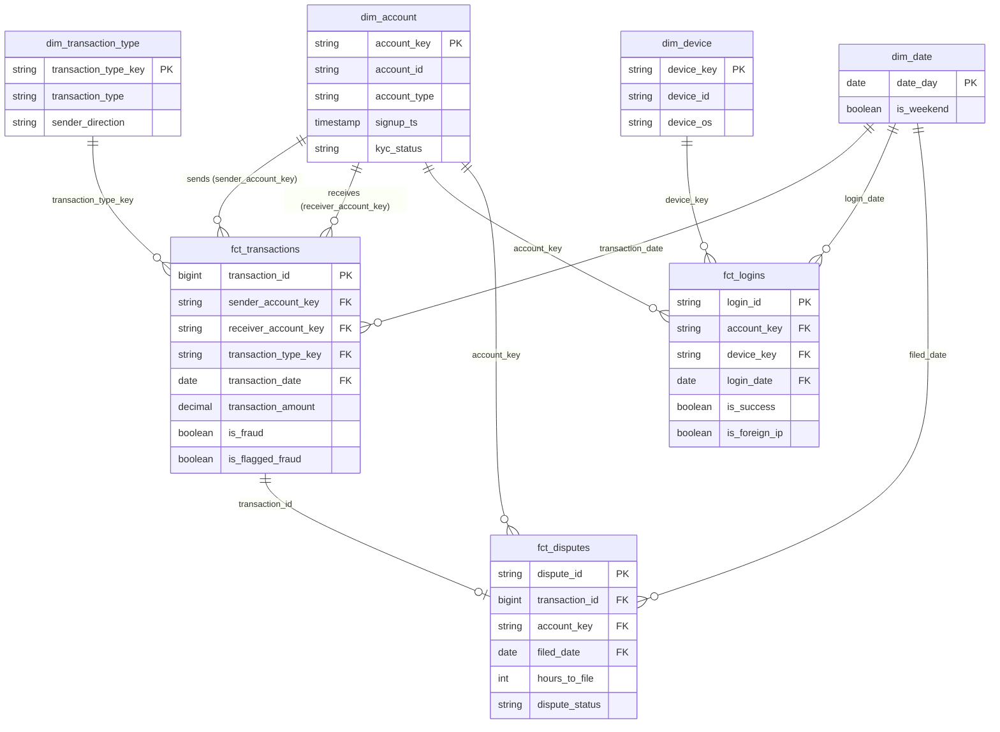

# Payments Risk Warehouse

[](https://github.com/karthikrk1/payments-risk-warehouse/actions/workflows/ci.yml)

A dbt-based risk data platform for a peer-to-peer payments product: it turns raw transaction,
account, device, login and dispute data into a tested **dimensional warehouse** and a
**point-in-time-correct ML feature table** for fraud detection, with data quality and lineage
monitoring built in.

> **Status:** 🚧 In progress. Phase 1 (warehouse, features, tests, docs) is under active development.

**Live docs and lineage graph:** _link to GitHub Pages once published_

---

## Why this project

Risk teams at payments companies need trustworthy data foundations before they can build detection
models or reporting: clean entity models, consistent metric definitions, features that don't leak
future information, and monitoring that catches bad data before it reaches decisions. This project
builds that foundation end to end on public, synthetic data.

## Architecture

```
 PaySim CSV ─┐
             ├─► ingestion (Python) ─► DuckDB `raw` ─► dbt staging ─► intermediate ─► marts
 Synthetic   │                                                         (features)     ├─ core: dim_* / fct_*
 entities ───┘                                                                        └─ ml:   ml_transaction_features
                                                    dbt tests + docs (lineage, data dictionary)
```

_Replace with a proper diagram in `docs/architecture.md` (e.g. Mermaid or Excalidraw)._

| Layer | Purpose | Examples |
|---|---|---|
| Staging | 1:1 with sources: rename, cast, clean | `stg_paysim__transactions`, `stg_app__logins` |
| Intermediate | Joins and risk features | `int_account_velocity`, `int_device_sharing` |
| Marts / core | Star schema for analytics | `fct_transactions`, `dim_account`, `dim_device` |
| Marts / ml | ML-ready, leakage-safe features | `ml_transaction_features` |

## Data

- **Transactions:** [PaySim](https://www.kaggle.com/datasets/ealaxi/paysim1), a synthetic mobile-money
  dataset (~6.3M transactions) with fraud labels.
- **Accounts, devices, logins, disputes:** generated by `ingestion/generate_entities.py` with a fixed
  seed, to cover the identity, account-access and dispute domains that PaySim lacks.

All data is synthetic; no real customer data is used.

### What PaySim looks like

Profiled on load (6,362,620 transactions):
- **743 hourly steps,** about 31 days. `transaction_ts` = `paysim_start_date` (2024-01-01) + (step − 1) hours.
- **8,213 fraudulent transactions (0.13%),** all `TRANSFER` or `CASH_OUT`. The legacy `isFlaggedFraud`
  rule fires on only 16.
- **99.85% of sending accounts appear exactly once,** so per-sender velocity is almost always empty.
  Receiving accounts repeat (572k accounts receive 4.2M transactions), so velocity is built on both sides.
- **16 transactions have amount 0;** the amount check is a warning, not an error.
- PaySim has no transaction ID, so `source_row_number` (the data row in the file) becomes `transaction_id`.

### How the synthetic entities are generated

| Table | Rows | Grain |
|---|---:|---|
| `raw.app_accounts` | 6,923,499 | One row per customer account in PaySim (merchants excluded) |
| `raw.app_devices` | 6,323,442 | One row per device seen in a login |
| `raw.app_logins` | 6,750,849 | One row per login attempt: a successful login before each sending transaction, plus any failed attempts |
| `raw.app_disputes` | 9,896 | One row per disputed transaction, filed 1 hour to 14 days after it |

- **Reproducible:** every value is derived from an MD5 hash of a fixed seed and a key, not a random-number
  generator, so a re-run produces identical data even though DuckDB runs SQL in parallel (byte-identical
  files on the same DuckDB version; Parquet files record the version that wrote them).
- **Planted signal, on purpose:** fraudulent senders more often have failed logins before the transaction
  (30% vs 4% of transactions) and more often use a device shared with other fraudulent accounts (30% vs 1%).
  This lets the feature pipeline be checked end to end. **It is synthetic:** features built on logins and
  devices show that the pipeline works, not that these signals predict real fraud. The settings are in
  `PLANTED_SIGNAL` in `generate_entities.py` and recorded in `data/raw/generated/manifest.json`.
- **Independent of the label:** account age, KYC status, country, login IP country and device OS.
- **Disputes follow fraud,** as they do in reality: 40% of fraudulent transactions are disputed, and a small
  share of legitimate ones. A dispute is always filed after its transaction, and some are filed after the
  31-day window ends.

## Data model

The star schema in `core` (row counts on the full data):



| Model | Grain | Rows |
|---|---|---:|
| `fct_transactions` | one row per transaction (incremental) | 6,362,620 |
| `fct_logins` | one row per login attempt | 6,750,849 |
| `fct_disputes` | one row per dispute | 9,896 |
| `dim_account` | one row per account: 6,923,499 customers + 2,150,401 merchants | 9,073,900 |
| `dim_device` | one row per device | 6,323,442 |
| `dim_date` | one row per day, 2021-01-01 to 2024-02-29 | 1,155 |
| `dim_transaction_type` | one row per type, from a seed | 5 |

- **Merchants are in `dim_account`** (with no signup, KYC or country), so every receiver key resolves.
- **Surrogate keys** are `dbt_utils.generate_surrogate_key` of the natural key. Facts compute the same hash
  instead of joining to the dimension; relationship tests prove every key resolves. Natural keys are kept
  alongside.

## Key design decisions

1. **Point-in-time features.** Every feature in `ml_transaction_features` uses only data available
   before the transaction, enforced by a dedicated dbt test, to prevent label leakage.
2. **Flag, don't drop, and know when a flag is a leak.** PaySim's inconsistent balances are kept and
   flagged (`has_balance_mismatch`) rather than filtered. Inconsistency is the norm, not the exception: on
   outgoing transfers the sender's balance adds up only 4.8% of the time. But the after-balances and the
   flags describe the account *after* the transaction, which a real-time check wouldn't know, and in PaySim
   they nearly reveal the label. On transfers and cash-outs, the sender's balance adds up in 99.45% of
   fraudulent transactions vs 9.9% of legitimate ones, and fraud empties the sender's account exactly
   97.7% of the time vs 0.0% for legitimate ones. The dataset's author goes further: fraudulent
   transactions were cancelled in the simulation, so *none* of the four balance columns should be used
   for fraud detection, before-balances included. So every balance column is kept for analysis and
   data-quality reporting, and none feeds an ML feature.
3. **Incremental fact table.** `fct_transactions` builds incrementally (`delete+insert` on
   `transaction_id`), mirroring how high-volume event data is processed in production. A later run loads
   only transactions with a higher `transaction_id` than any already loaded. That rule is only correct
   because `transaction_id` is the row number in a file that is in time order (checked: `step` never
   decreases), so new data always has higher ids; `delete+insert` makes a re-processed row replace rather
   than duplicate. Verified by deleting the last 362,620 rows and re-running: they came back in 0.25 s,
   with 0 rows differing from a full build. A no-op run takes 0.05 s against about 2 s for a full build.
4. **Portable SQL.** Models target DuckDB locally but avoid dialect-specific SQL so they port to
   Snowflake with minimal changes.

_Expand each with the trade-offs you considered._

## Data quality

- Primary-key, foreign-key and accepted-value tests on every model
- Range and freshness checks on amounts and timestamps
- A leakage test on the ML feature table
- Warn-level tests for known, rare source quirks; error-level for integrity breaks

**Today:** 12 models and a seed, 127 tests; a full build on 6.36M transactions takes about 6 seconds.
- **Staging:** keys, relationships across sources (logins → accounts and devices, disputes →
  transactions, senders and customer receivers → accounts), accepted values, ranges, and four singular
  tests (fraud only on transfers and cash-outs; timestamps inside the 31-day window; disputes filed after
  their transaction by its sender; accounts opened before their first transaction).
- **Core:** primary keys; every fact foreign key resolves to its dimension; every date is in `dim_date`;
  each fact has exactly as many rows as its staging model (`dbt_utils.equal_rowcount`), so no join
  silently drops or duplicates rows.
- The one expected warning is the 16 zero-amount transactions.

**Money is `decimal(18, 2)`.** PaySim balances are often off by exactly one cent. In floating point that
difference reads as 0.0100000000093, over a 0.01 tolerance, so a float-based check misclassified about
680k transactions.

## Results

_Fill in from real query output, e.g. fraud rate by transaction type, how the legacy
`isFlaggedFraud` rule compares with simple velocity features, test coverage._

## Quickstart

Requires macOS or Linux and [uv](https://docs.astral.sh/uv/). `make help` lists every target.

```bash
git clone https://github.com/karthikrk1/payments-risk-warehouse.git
cd payments-risk-warehouse
make setup     # .venv with Python 3.12, dependencies and dev tools
make data      # PaySim from Kaggle -> data/raw/paysim.csv (needs a Kaggle API token, see below)
make ingest    # generate entities (~10 s), load everything into DuckDB's raw schema (~10 s)
make build     # dbt deps + dbt build
make docs      # dbt docs: lineage graph and data dictionary
```

**Kaggle token:** on kaggle.com, Settings → API → Create New Token, then move the downloaded
`kaggle.json` to `~/.kaggle/kaggle.json` and run `chmod 600 ~/.kaggle/kaggle.json`. Or download
[PaySim](https://www.kaggle.com/datasets/ealaxi/paysim1) in the browser and save the CSV as
`data/raw/paysim.csv`.

Generated files go to `data/raw/generated/` and the warehouse to `warehouse/risk.duckdb`; both are
git-ignored. About 1 GB of disk in total.

## Development workflow

- `main` is protected: changes land only through pull requests, and `main` can't be force-pushed
  or deleted.
- Every pull request runs [CI](.github/workflows/ci.yml): **lint** (ruff) and **dbt**, which runs the
  whole pipeline (generate entities, load raw, `dbt build` with every test) on a committed
  4,904-row PaySim sample in [`data/sample/`](data/sample/README.md). Both must pass before merging.
- Dependabot opens weekly pull requests for GitHub Actions and the direct Python dependencies.

Run the same checks locally:

```bash
make lint       # ruff
make ci-build   # pipeline on the sample -> warehouse/ci.duckdb (your full warehouse is untouched)
```

`make sample` rebuilds the sample from the full CSV, deterministically. Fraud is over-represented in
it (12% vs 0.13%) so tests have cases to work on; results always come from the full data.

## Roadmap

- [ ] Phase 1: staging, star schema, risk features, ML feature table, tests, hosted dbt docs
- [ ] Orchestration with Prefect (dependency checks, SLA alerts)
- [ ] Data observability with Elementary
- [ ] Snowflake target provisioned with Terraform
- [ ] GitHub Actions CI running `dbt build` on every pull request
- [ ] AI triage agent: classifies failed dbt tests and suggests fixes using the Claude API

## Tools

Python · uv · dbt Core · DuckDB · _(planned)_ Prefect · Elementary · Snowflake · Terraform · GitHub Actions · Claude API

Built with AI-assisted development (Claude Code); see `CLAUDE.md` for the project conventions it follows.
