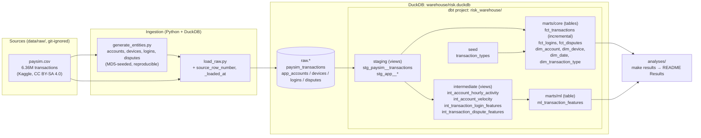
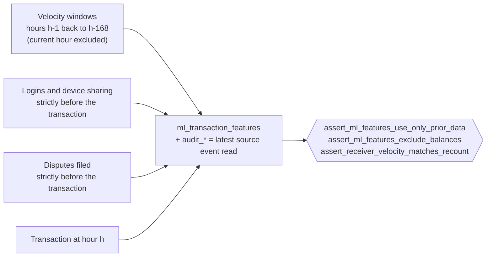
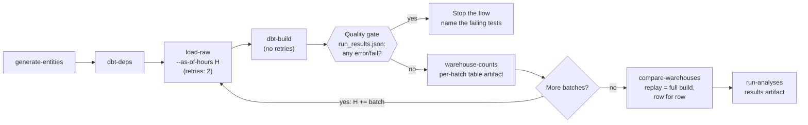
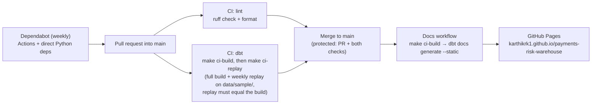

# Architecture

How data flows through payments-risk-warehouse, and how the repo is built, tested and published.
For the reasoning behind each choice, see [Key design decisions](../README.md#key-design-decisions)
in the README; for every model and column, see the
[live dbt docs](https://karthikrk1.github.io/payments-risk-warehouse/).

## Data flow

| Layer | Schema | Materialized | Rule |
|---|---|---|---|
| Raw | `raw` | tables (loaded by Python) | As delivered; only `source_row_number` and `_loaded_at` added |
| Staging | `staging` | views | One model per source table: rename, cast, clean. No joins |
| Intermediate | `intermediate` | views | Joins and point-in-time feature logic |
| Core | `core` | tables (`fct_transactions` incremental) | Star schema for analytics |
| ML | `ml` | table | One row per transaction: features, label, baseline, audit columns |

Schemas are used as named (`macros/generate_schema_name.sql`), not prefixed with `main_`.

## Point-in-time features

Every feature group records the latest source event it read in an `audit_*` column, and the tests
fail if any is not before the transaction, if a balance column appears, or if the window functions
disagree with a brute-force recount. Each test was checked by breaking the model on purpose.

## Orchestration and replay (Prefect)

`flows/pipeline.py` runs in two modes:
- **full** (`make flow`): one batch with no cutoff, the same as `make ingest` + `make build` +
  `make results`, orchestrated.
- **replay** (`make replay`, `make ci-replay`): start from an empty warehouse and load one batch of
  simulated time at a time (a day locally, a week in CI), with `dbt build` and the gate after each, until
  the last late dispute has arrived. The incremental `fct_transactions` grows batch by batch. At the end
  every `core` and `ml` table must equal a one-shot full build.

`load_raw.py --as-of-hours H` decides what existed at the cutoff: transactions by `step`, and each
entity by the time it became known (`signup_ts`, `first_seen_ts`, `login_ts`, `filed_ts`). Each run
builds its own warehouse file (`WAREHOUSE_PATH`), so replay never touches the full build.

## Build, test and publish

- **The sample** (`data/sample/paysim_sample.csv`, 4,904 rows, `make sample`) lets CI run the whole
  pipeline on real data in about 25 seconds, so model, test and dependency changes are exercised, not
  just parsed. Its fraud rate is skewed on purpose; results always come from the full data.
- **Separate warehouses, never mixed:** `warehouse/risk.duckdb` (full data, dbt target `dev`),
  `warehouse/ci.duckdb` (sample, target `ci`), and the replay copies `warehouse/replay.duckdb` and
  `warehouse/ci_replay.duckdb`.

## Commands

| Command | What it does |
|---|---|
| `make setup` | `.venv` with Python 3.12, dependencies and dev tools |
| `make data` | Download PaySim from Kaggle to `data/raw/paysim.csv` |
| `make ingest` | Generate entities, load everything into `raw` (full data) |
| `make build` | `dbt deps` + `dbt build` on the full data |
| `make results` | Run the analyses and print the README Results tables |
| `make ci-build` | The whole pipeline on the sample (what CI runs) |
| `make flow` | The full pipeline on the full data as a Prefect flow |
| `make replay` | Replay the full data day by day; must equal `make build` |
| `make ci-replay` | Replay the sample week by week; must equal `make ci-build` (what CI runs) |
| `make docs` | Generate and serve the dbt docs locally |
| `make lint` / `make format` | Ruff |
| `make sample` | Rebuild the committed CI sample from the full CSV |
| `make clean` | Delete generated data, warehouse files and dbt output |
